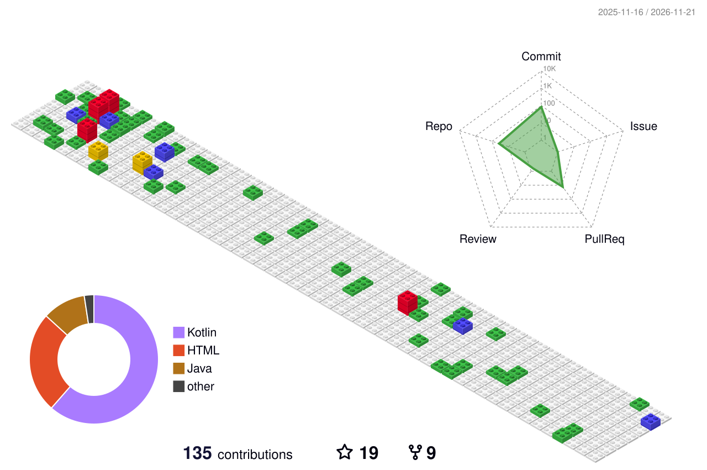

  
  
  

### 你好，我是 YuaZer

我主要从事 Minecraft 模组与插件开发，也会制作跨平台应用和自动化工具，喜欢把想法做成能实际使用的项目。

- 🎮 Minecraft 模组与插件开发
- 📱 跨平台应用开发(iOS/Android/PC)
- 🤖 自动化工具与 AI 应用探索

### 项目展示

| 项目 | 简介 | 技术栈 |
| --- | --- | --- |
| [MagicRender](https://github.com/YuaZer/MagicRender) | 为 Minecraft 添加支持自定义运动轨迹的特效渲染能力 | Kotlin · JavaScript |
| [CobbleHunt](https://github.com/YuaZer/CobbleHunt) | 高度可配置的 Minecraft 任务插件 | Kotlin |
| [QLCustomSpawn](https://github.com/YuaZer/QLCustomSpawn-1.21.1) | 支持权重与自定义配置的生物刷新插件 | Kotlin |

### 技术栈

  

**主要使用：** Kotlin · Java · Dart / Flutter  
**也有涉猎：** TypeScript · JavaScript · Python · Go · C#

### 贡献与常用语言

  

<picture>
  <source media="(prefers-color-scheme: dark)" srcset="./snake/github-contribution-grid-snake-dark.svg" />
  <source media="(prefers-color-scheme: light)" srcset="./snake/github-contribution-grid-snake.svg" />
  
</picture>

